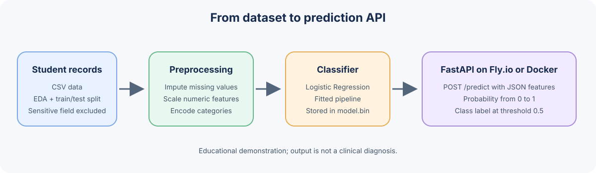

<div align="center">


# Student Depression Classification

### A reproducible machine-learning API for an educational classification project

[](.python-version)
[](predict.py)
[](train.py)
[](Dockerfile)

[Live API](https://crimson-skylark-7823.fly.dev) · [API documentation](https://crimson-skylark-7823.fly.dev/docs) · [OpenAPI schema](https://crimson-skylark-7823.fly.dev/openapi.json) · [Notebook](student-depression-notebook-correct-workflow.ipynb)

</div>

> [!IMPORTANT]
> This is an educational project. It estimates a label in the source dataset; it does **not** provide a mental-health assessment, diagnosis, or care recommendation. Do not use an individual prediction to make decisions about a student.

## At a glance

| | |
| --- | --- |
| **Task** | Binary classification: estimate the dataset label `depression` |
| **Data** | Indian Student Depression Dataset · 27,901 records · 18 columns |
| **Final model** | Logistic Regression (`C=1`) with a fitted preprocessing pipeline |
| **Evaluation** | Test ROC-AUC: **0.875** · Test accuracy: **0.803** |
| **Service** | FastAPI · `POST /predict` · Docker · Fly.io |

## Contents

- [Problem](#problem)
- [Results](#results)
- [Project flow](#project-flow)
- [Repository layout](#repository-layout)
- [Run locally](#run-locally)
- [Make a prediction](#make-a-prediction)
- [Retraining and analysis](#retraining-and-analysis)
- [Docker](#docker)
- [Manual Fly.io deployment](#manual-flyio-deployment)
- [Limitations](#limitations)

---

## Problem

This project explores whether demographic, academic, work, and lifestyle fields can predict the `depression` label supplied with a student record. It is a complete Machine Learning Zoomcamp workflow: exploratory analysis, model comparison, model export, a web API, and containerized deployment.

Two fields are deliberately excluded from the deployed model:

- `id` is an identifier, so it has no predictive role.
- `suicidal_thoughts` is highly sensitive and closely related to the target label. The API does not ask for it and the model does not use it.

## Dataset

The repository contains the original data and the fixed splits used for training and evaluation, so the project can be run without a separate download.

| File | Rows | Purpose |
| --- | ---: | --- |
| `Student Depression Dataset.csv` | 27,901 | Original source dataset used in the notebook |
| `student-depression-full-train.csv` | 22,320 | Final model training data |
| `student-depression-test.csv` | 5,581 | Held-out evaluation data |

The notebook standardizes text and column names, converts sleep-duration ranges to numeric midpoints, and fits missing-value handling within the model pipeline. The dataset is observational, so its labels, collection process, and population may limit how well results generalize.

## Results

The notebook evaluates Logistic Regression, Decision Tree, and Random Forest models. Hyperparameters are chosen with a validation split, then the selected configurations are compared using stratified five-fold cross-validation.

| Model | Selected configuration | Mean 5-fold ROC-AUC |
| --- | --- | ---: |
| **Logistic Regression** | `C=1` | **0.870 ± 0.003** |
| Random Forest | `n_estimators=500`, `max_depth=15`, `min_samples_leaf=2` | 0.867 ± 0.003 |
| Decision Tree | `max_depth=7`, `min_samples_leaf=50` | 0.846 ± 0.003 |

The selected Logistic Regression model is trained on the full training split and evaluated once on the held-out test set: **ROC-AUC 0.875** and **accuracy 0.803** at a 0.5 decision threshold.

## Project flow



1. The notebook cleans the source data, explores it, and creates reproducible train/test splits.
2. The fitted scikit-learn pipeline imputes missing values, scales numeric fields, and one-hot encodes categories.
3. `train.py` saves the fitted pipeline as `model.bin`.
4. `predict.py` validates JSON input and returns a probability plus a thresholded prediction.

## Repository layout

```text
.
├── dataset/
│   ├── Student Depression Dataset.csv         # Source dataset
│   ├── student-depression-full-train.csv      # Final training split
│   └── student-depression-test.csv            # Held-out test split
├── docs/project-flow.svg                      # Architecture diagram
├── student-depression-notebook-correct-workflow.ipynb
├── train.py                                   # Train and export model.bin
├── predict.py                                 # FastAPI application
├── predict-simple.py                          # Example API client
├── model.bin                                  # Fitted scikit-learn pipeline
├── Dockerfile                                 # Production container image
├── fly.toml                                   # Fly.io configuration
├── pyproject.toml                             # Python dependencies
└── uv.lock                                    # Locked dependency versions
```

## Run locally

### 1. Prerequisites

- Python **3.14**
- [`uv`](https://docs.astral.sh/uv/getting-started/installation/)
- Docker, only if you want to use the container workflow

Confirm that `uv` is available, then enter the cloned repository:

```bash
uv --version
cd ml-zoomcamp-2026-mid-term-project
```

### 2. Install the locked environment

```bash
uv sync --locked
```

This creates `.venv` and installs the exact locked dependency versions. The committed `model.bin` is ready to serve; you do not need to retrain before starting the API.

### 3. Start the API

```bash
uv run uvicorn predict:app --host 0.0.0.0 --port 9696
```

Open one of these URLs in your browser:

| URL | Purpose |
| --- | --- |
| `http://localhost:9696/` | Basic service response |
| `http://localhost:9696/docs` | Interactive Swagger UI |
| `http://localhost:9696/openapi.json` | Machine-readable API schema |

Press `Ctrl+C` in the terminal to stop the server.

## Make a prediction

With the server running, send a `POST` request to `/predict`:

```bash
curl -X POST http://localhost:9696/predict \
  -H 'Content-Type: application/json' \
  -d '{
    "gender": "male",
    "age": 20,
    "city": "mumbai",
    "profession": "student",
    "academic_pressure": 2,
    "work_pressure": 0,
    "cgpa": 7.27,
    "study_satisfaction": 3,
    "job_satisfaction": 0,
    "work_or_study_hours": 9,
    "sleep_duration": "6-7_hours",
    "dietary_habits": "healthy",
    "financial_stress": 3,
    "family_history_of_mental_illness": "no",
    "degree": "class_12"
  }'
```

```json
{
  "depression_probability": 0.64,
  "depression_prediction": 1
}
```

The response above is an example. `depression_prediction` is `1` when the estimated probability is at least `0.5`; otherwise it is `0`. The API validates required fields and ranges. Use `/docs` to inspect accepted categorical values, including the full `degree` list.

An example client is also included:

```bash
uv run python predict-simple.py
```

## Retraining and analysis

### Train the serving artifact

```bash
uv run python train.py
```

This reads `dataset/student-depression-full-train.csv` and overwrites `model.bin`. Restart the API after retraining so it loads the new model.

### Reproduce the notebook

Open [student-depression-notebook-correct-workflow.ipynb](student-depression-notebook-correct-workflow.ipynb) in VS Code, Jupyter, or another notebook-capable editor and run it from top to bottom. It performs data preparation, EDA, feature analysis, tuning, cross-validation, final evaluation, and writes the fixed train/test splits under `dataset/`.

## Docker

Build the image:

```bash
docker build -t student-depression-api .
```

Start the container:

```bash
docker run --rm -p 9696:9696 student-depression-api
```

The API will be available at `http://localhost:9696/docs`. Stop it with `Ctrl+C`. Rebuild the image after changing `predict.py` or `model.bin`.

## Manual Fly.io deployment

The configured Fly.io application is [`crimson-skylark-7823`](https://crimson-skylark-7823.fly.dev). Deployment is manual; pushes to GitHub do not deploy the service.

Install [`flyctl`](https://fly.io/docs/flyctl/install/), sign in, and run these commands from the repository root:

```bash
fly auth login
fly status --app crimson-skylark-7823
fly deploy --app crimson-skylark-7823
fly status --app crimson-skylark-7823
```

Fly.io routes HTTPS traffic to port `9696` as configured in `fly.toml`. After a successful deploy, visit [the live API](https://crimson-skylark-7823.fly.dev) or [its interactive docs](https://crimson-skylark-7823.fly.dev/docs).

## Limitations

- The target is a source-dataset label, not a diagnosis, and may contain label noise.
- The data is observational and may not represent students in other populations or settings.
- The positive class is about 58.6% of the dataset, and performance depends on this particular split.
- Correlations in the data should not be interpreted as causes.
- The default 0.5 threshold is not clinically or operationally validated.

## Project guidance

This project follows the [Machine Learning Zoomcamp project deliverables](https://github.com/DataTalksClub/machine-learning-zoomcamp/tree/main/projects) and [project tips and checklist](https://github.com/DataTalksClub/machine-learning-zoomcamp/blob/main/projects/project-tips.md).
