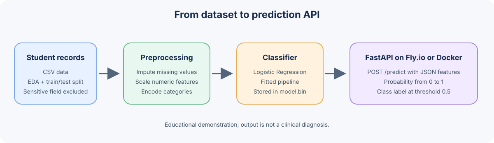

# Student Depression Classification

A machine learning project from the [DataTalks.Club Machine Learning Zoomcamp](https://github.com/DataTalksClub/machine-learning-zoomcamp/tree/main/projects). It trains a binary classifier on the Indian Student Depression Dataset and serves predictions through a FastAPI web service.

**Live Fly.io app (configured URL):** [https://crimson-skylark-7823.fly.dev](https://crimson-skylark-7823.fly.dev) · [Interactive API docs](https://crimson-skylark-7823.fly.dev/docs) · [OpenAPI schema](https://crimson-skylark-7823.fly.dev/openapi.json)

> The Fly.io app name and hostname are taken from `fly.toml`. The public endpoint could not be reached during this README update, so its current availability has not been verified. If it is sleeping, give Fly.io a moment to start it and retry.

> **Educational use only.** The prediction estimates a dataset label; it is not a mental health assessment, diagnosis, or recommendation for care. Do not use it to make decisions about an individual student. The data contains sensitive information and model outputs can be wrong or biased.

## Problem and intended use

The dataset includes demographic, academic, work, and lifestyle fields for students in India. The model estimates the probability that a record has `depression = 1` in the source dataset. This project demonstrates an end-to-end machine learning workflow: data exploration, model comparison, training, packaging, and local API deployment. It is not intended for real-world screening or intervention.

The notebook excludes `suicidal_thoughts` from model features because it is sensitive and closely associated with the target. The serving API does not ask for this field. The record identifier (`id`) is also excluded.

## Dataset

The repository includes the source data and the fixed train/test split used for the final model:

| File | Contents |
| --- | --- |
| `dataset/Student Depression Dataset.csv` | Original dataset (27,901 rows, 18 columns) used in the notebook |
| `dataset/student-depression-full-train.csv` | Training portion used by `train.py` (22,320 rows) |
| `dataset/student-depression-test.csv` | Held-out test portion created by the notebook (5,581 rows) |

The target is `depression`. The notebook standardizes column names and categorical text and converts sleep-duration ranges to numeric midpoints. The split preserves the target proportions. Missing values are handled in the model pipeline. The dataset is committed in this repository, so no separate download is required to reproduce the notebook or training script.

The dataset is an observational source dataset, not a clinical cohort. Its labels, population, collection process, and feature distributions may limit how well the results generalize. Associations in the data do not imply causes.

## Exploration and model selection

Run `student-depression-notebook-correct-workflow.ipynb` for the data cleaning, exploratory analysis, feature analysis, model comparison, hyperparameter selection, and held-out test evaluation. The notebook compares Logistic Regression, Decision Tree, and Random Forest models. It tunes model parameters using a validation set, compares selected configurations with stratified five-fold cross-validation, and reports performance on the held-out test split.

The saved notebook results select Logistic Regression with `C=1`. Its mean five-fold training-split ROC-AUC is **0.870 ± 0.003**, and its held-out test ROC-AUC is **0.875** (test accuracy **0.803** at a 0.5 threshold). These are results on this dataset split, not guarantees of future performance.

## Project files

```text
.
├── dataset/                                  # Source data and train/test splits
├── student-depression-notebook-correct-workflow.ipynb
├── train.py                                  # Fits the serving pipeline and writes model.bin
├── model.bin                                 # Serialized fitted scikit-learn pipeline
├── predict.py                                # FastAPI application and input validation
├── predict-simple.py                         # Optional example HTTP client
├── pyproject.toml                            # Project dependencies and metadata
├── uv.lock                                   # Locked dependency versions
└── Dockerfile                                # Container image for the API
```

## How a prediction is produced



The request schema validates the supplied values, `predict.py` converts the request into a one-row table and normalizes the sleep-duration value, then the fitted scikit-learn pipeline applies imputation, scaling and one-hot encoding before returning a probability and a thresholded class. The service exposes `GET /` and `POST /predict`; FastAPI also serves its interactive schema at `/docs`.

## Requirements

- Python **3.14** (version is recorded in `.python-version`)
- [`uv`](https://docs.astral.sh/uv/) for creating the environment and installing the locked dependencies
- Docker, if you want to run the containerized API

### Install `uv`

If `uv` is not installed, follow the [official installation instructions](https://docs.astral.sh/uv/getting-started/installation/) for your operating system. Confirm it is available, then move to the repository root:

```bash
uv --version
cd ml-zoomcamp-2026-mid-term-project
```

Use a Python 3.14 installation. `uv` can use an installed interpreter or download one when needed.

## Run locally

From the repository root, create the virtual environment and install exactly the versions recorded in `uv.lock`:

```bash
uv sync --locked
```

This creates `.venv` and installs the project plus its development dependency (`requests`, used by the example client). Start the API:

```bash
uv run uvicorn predict:app --host 0.0.0.0 --port 9696
```

The service listens on port `9696`. Open `http://localhost:9696/` for the service message or `http://localhost:9696/docs` for the interactive Swagger UI.

To stop the server, press `Ctrl+C` in the terminal where it is running. If port 9696 is already in use, stop the other process or change the port consistently in the run command and the URL used by the client.

### Send a prediction request

`POST /predict` accepts a JSON object with these fields. `gender`, `dietary_habits`, `family_history_of_mental_illness`, and `degree` are constrained to values listed by the API schema; see `/docs` for the full allowed `degree` set.

```bash
curl -X POST http://localhost:9696/predict \
  -H 'Content-Type: application/json' \
  -d '{
    "gender": "male",
    "age": 20,
    "city": "mumbai",
    "profession": "student",
    "academic_pressure": 2,
    "work_pressure": 0,
    "cgpa": 7.27,
    "study_satisfaction": 3,
    "job_satisfaction": 0,
    "work_or_study_hours": 9,
    "sleep_duration": "6-7_hours",
    "dietary_habits": "healthy",
    "financial_stress": 3,
    "family_history_of_mental_illness": "no",
    "degree": "class_12"
  }'
```

Example response:

```json
{
  "depression_probability": 0.64,
  "depression_prediction": 1
}
```

The probability and prediction above are illustrative; actual output depends on the bundled model. The class is `1` when the estimated probability is at least `0.5`, otherwise `0`. Invalid fields or values return a validation error. `age` must be between 18 and 59; pressure, satisfaction, CGPA, and financial-stress values are range-checked by the API. Sleep duration should contain a number or numeric range (for example, `7-8_hours`).

You can also run the included Python client while the API is running:

```bash
uv run python predict-simple.py
```

## Retrain the model

With dependencies installed, run from the repository root:

```bash
uv run python train.py
```

The script reads `dataset/student-depression-full-train.csv`, fits preprocessing and Logistic Regression, and overwrites `model.bin`. The API loads `model.bin` at prediction time. The notebook contains the fuller model-selection workflow; `train.py` is the compact script for producing the serving artifact.

To reproduce the analysis, launch Jupyter in the same environment (`uv run jupyter lab`) if Jupyter is installed, or open the notebook in an IDE that supports `.ipynb` files. Execute `student-depression-notebook-correct-workflow.ipynb` from top to bottom. It uses the source CSV and writes the derived split CSV files under `dataset/`. The API is served from the committed `model.bin`; rerun training after changing training data or code, then restart the API to use the newly written artifact.

## Run with Docker

Build the image from the repository root:

```bash
docker build -t student-depression-api .
```

Start the container and publish its API port:

```bash
docker run --rm -p 9696:9696 student-depression-api
```

The API is then available at `http://localhost:9696/`, with interactive documentation at `http://localhost:9696/docs`. Send the same `curl` request shown above to `http://localhost:9696/predict`.

The container includes the locked runtime dependencies, `predict.py`, and `model.bin`. To stop it, press `Ctrl+C` (or stop the container from another terminal). To rebuild after changing the model or service code, run the build command again and start a new container.

## Deploy to Fly.io

The configured application name is `crimson-skylark-7823` in `fly.toml`, which gives the app the hostname `https://crimson-skylark-7823.fly.dev`. This project also has a GitHub Actions workflow that deploys on pushes to `main` or `master` using the `FLY_API_TOKEN` repository secret.

For a manual deployment, install and sign in to [`flyctl`](https://fly.io/docs/flyctl/install/), then run these commands from the repository root:

```bash
fly auth login
fly status --app crimson-skylark-7823
fly deploy --app crimson-skylark-7823
fly status --app crimson-skylark-7823
```

`fly.toml` configures Fly.io to route HTTPS traffic to port `9696`, where Uvicorn listens inside the container. After deployment, check `https://crimson-skylark-7823.fly.dev/` and `/docs`. For automated deploys, add a Fly API token to the GitHub repository as an Actions secret named `FLY_API_TOKEN`. Fly deployments may incur charges depending on current account terms and machine usage; stop or destroy resources using Fly.io's current guidance when finished.

## Limitations

- The target reflects labels in one dataset; it is not a diagnosis and may include label noise.
- The dataset has more positive than negative target labels (about 58.6% positive), and model performance depends on this dataset and split.
- The records are observational, and the dataset may not represent other student populations or current conditions.
- The model uses demographic and other potentially sensitive attributes. Avoid using individual predictions to guide consequential decisions.
- The API's 0.5 threshold is a simple default, not a clinically or operationally validated decision threshold.

## Reproducibility and project guidance

The data, notebook, training code, saved model, dependency lock file, API, and Dockerfile are included to support review from a fresh checkout. To inspect the analysis, open the notebook in Jupyter; to exercise the service, follow the local or Docker instructions above.

This README follows the Machine Learning Zoomcamp [project deliverables and evaluation guidance](https://github.com/DataTalksClub/machine-learning-zoomcamp/tree/main/projects) and [project tips and checklist](https://github.com/DataTalksClub/machine-learning-zoomcamp/blob/main/projects/project-tips.md).
